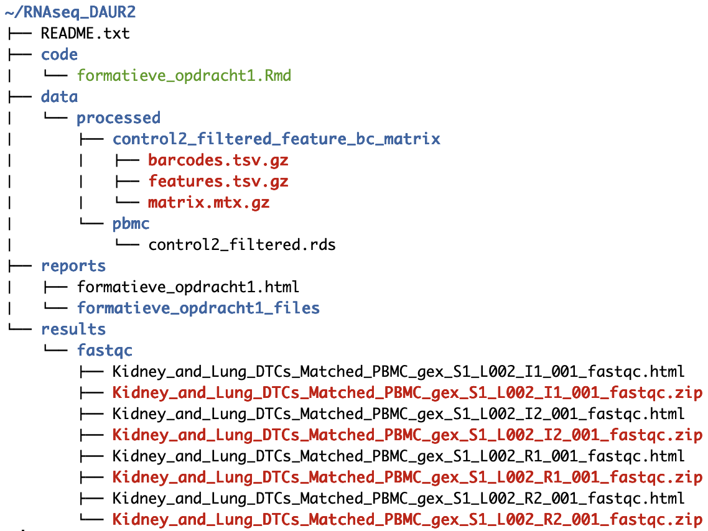
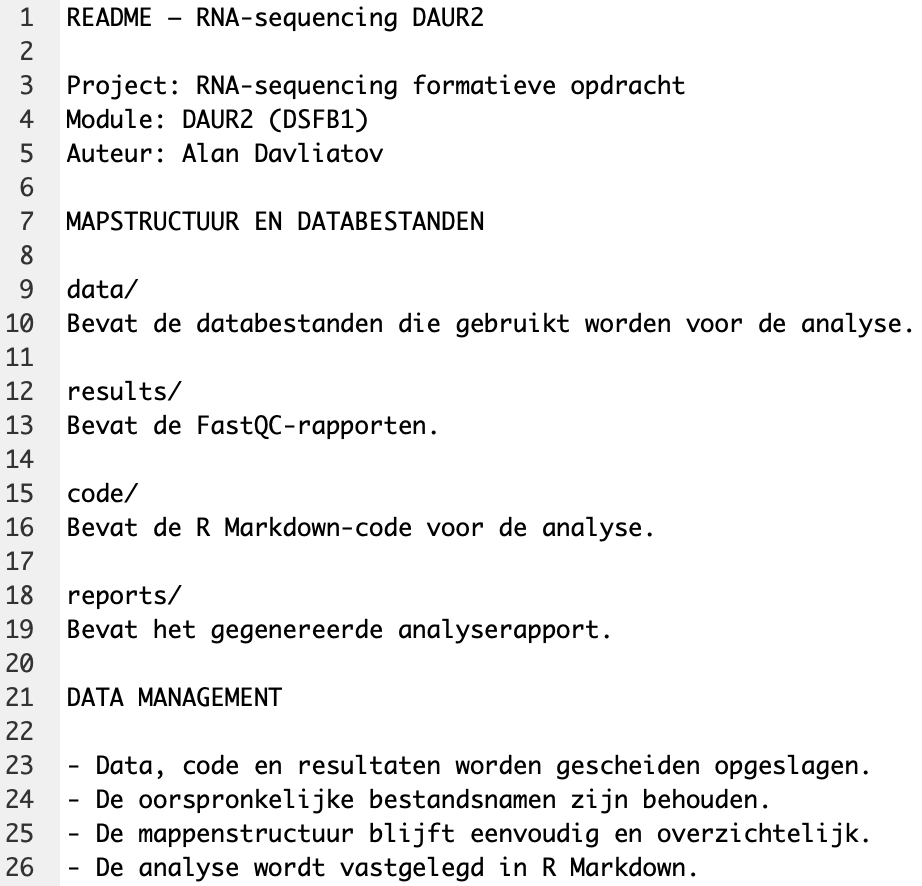
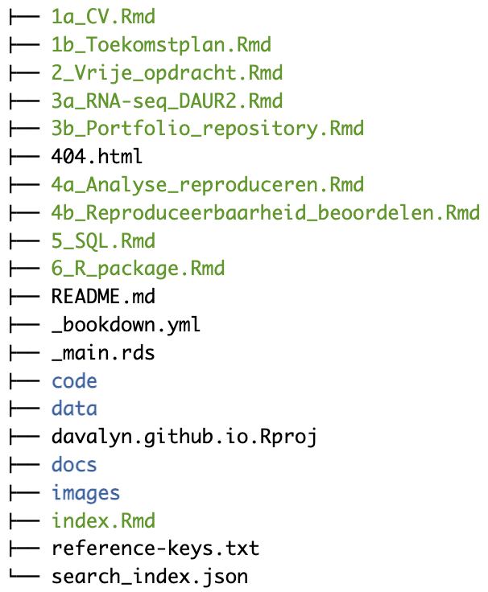
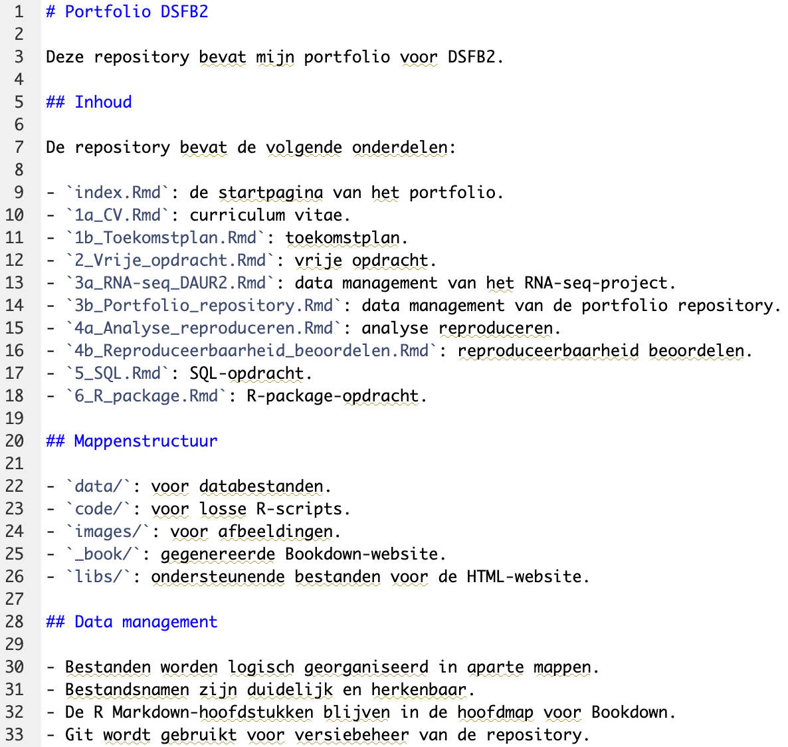

# Data management

In this section, I demonstrate how I applied the Guerilla Analytics data management principles to two projects: the RNA-seq formative assignment from DAUR2 and my DSFB2 portfolio repository.

## RNA-seq DAUR2

For this assignment, I applied the Guerilla Analytics data management principles to the RNA-seq formative assignment from the DAUR2 module. I created a structured folder hierarchy on my laptop to organise the different files, including FASTQ, BAM and count files. I also created a README file describing the contents and organisation of the folders.

### Folder structure

The folder structure was inspected using the `dir_tree()` function from the `fs` package.

```{r screenshot-structure, echo=FALSE, out.width="80%", fig.align="center"}

```

### README file

The README file provides an overview of the folder structure and explains where the different files are stored.

```{r screenshot-readme1, echo=FALSE, out.width="70%", fig.align="center"}

```

## Portfolio repository

I also applied the Guerilla Analytics data management principles to my DSFB2 portfolio repository. I organised the files into separate folders to maintain a clear and consistent structure. A README file was added to describe the repository and explain its organisation.

### Folder structure

The folder structure of my portfolio repository was inspected using the `dir_tree()` function from the `fs` package.

```{r portfolio-structure, echo=FALSE, out.width="50%", fig.align="center"}

```

### README file

The README file describes the contents of my portfolio repository and provides an overview of its organisation.

```{r screenshot-readme2, echo=FALSE, out.width="80%", fig.align="center"}

```