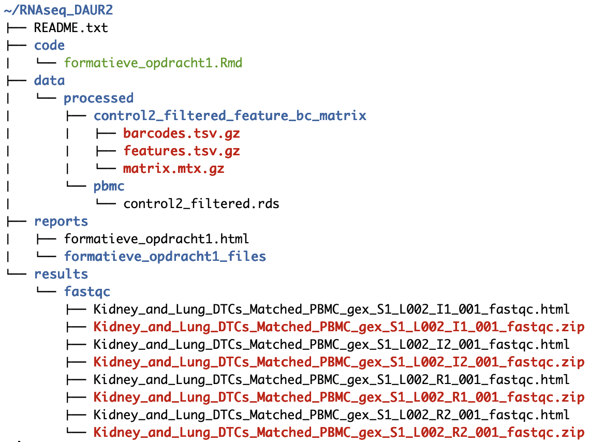
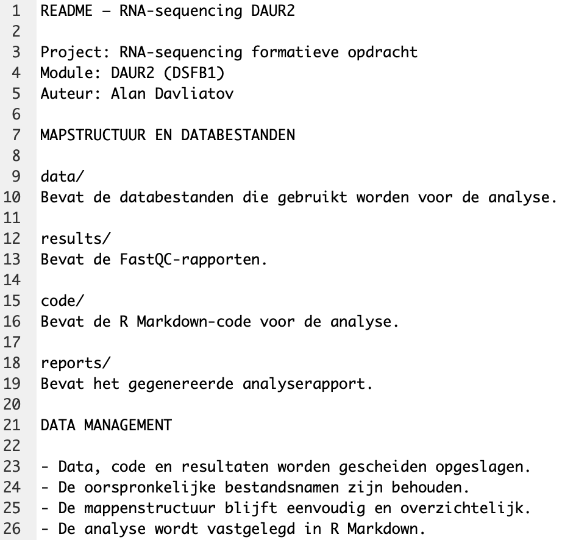

# RNA-seq DAUR2

**Screenshot 1 – Mappenstructuur**
```{r screenshot-structure, echo=FALSE, out.width="100%"}

```


**Screenshot 2 – README**
```{r screenshot-readme, echo=FALSE, out.width="100%"}

```