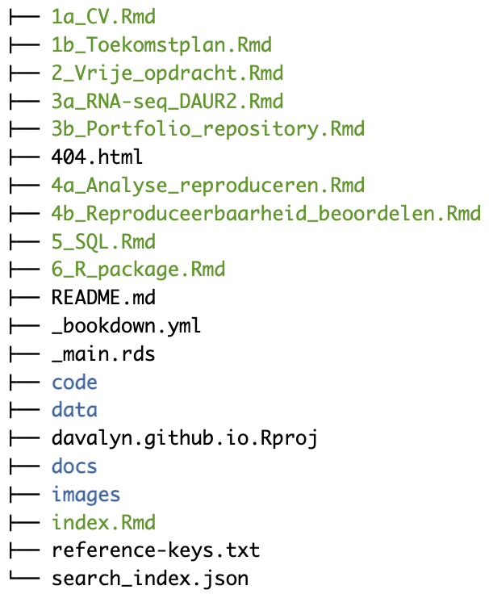
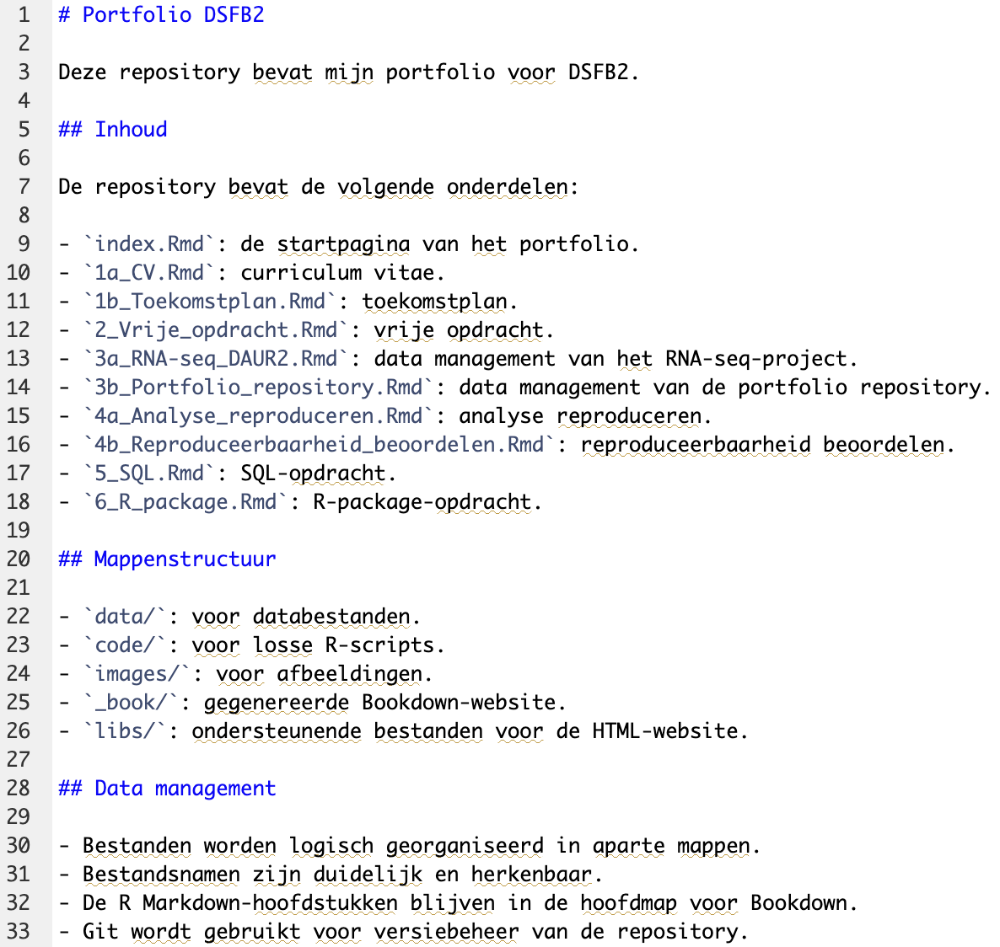

# Portfolio repository

## Screenshot 1 – Portfolio structuur:
```{r portfolio-structure, echo=FALSE, out.width="70%"}

```


## Screenshot 2 – README:
```{r screenshot-readme, echo=FALSE, out.width="80%"}

```