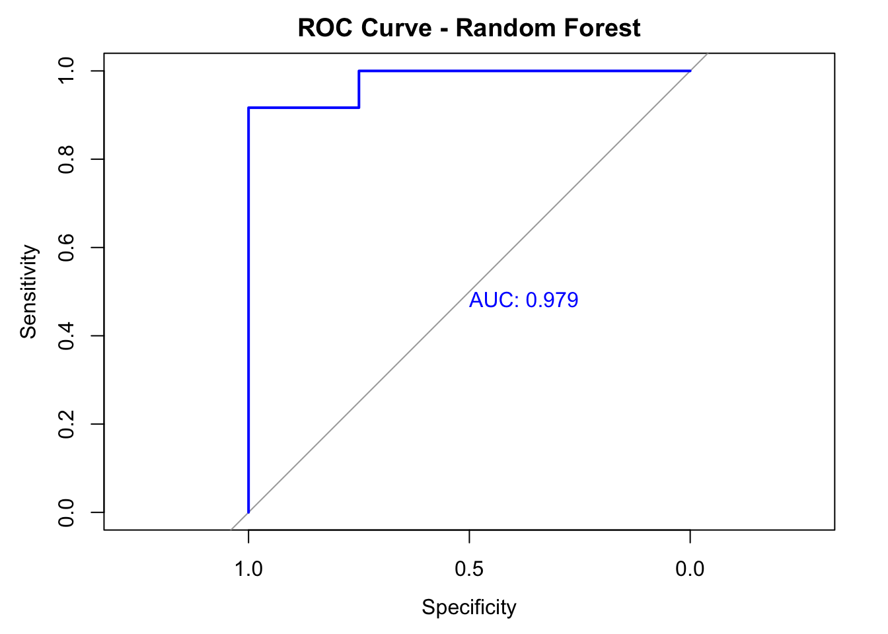
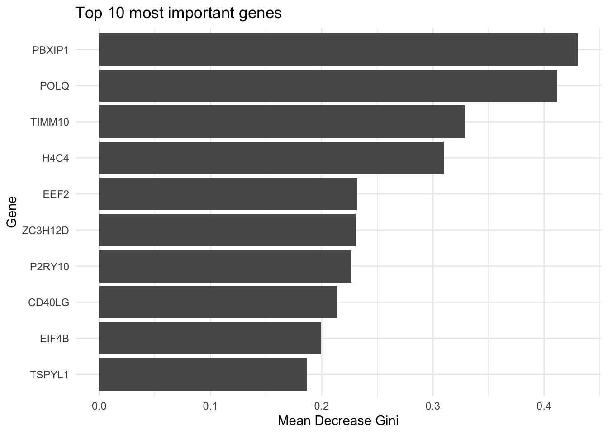

# Machine Learning for cancer classification

<h4>Which new skill do you want to learn and why?</h4>

I want to learn how to apply Machine Learning to biological data using R. I already have experience with R and RNA-seq data analysis, but Machine Learning is a completely new skill for me. Since I want to further develop my skills in bioinformatics and computational biology, I would like to learn how algorithms can recognise patterns and make predictions.

<h4>How are you going to learn this skill and what is your plan?</h4>

With 32 hours available for this project, my plan is as follows:

| Activity | Time |
|---|---:|
| Machine Learning theory and fundamentals | 4 hours |
| Learning to work with tidymodels | 5 hours |
| Finding and exploring a dataset | 3 hours |
| Data preprocessing | 5 hours |
| Applying Random Forest | 6 hours |
| Evaluating and comparing models | 5 hours |
| Reporting the results | 4 hours |
| **Total** | **32 hours** |

<h4>How are you going to demonstrate that you have mastered this skill?</h4>

I want to use a publicly available gene expression dataset to answer the following research question:

*"Can machine learning algorithms distinguish between healthy and COVID-19-affected tissue based on gene expression data?"*

The final product will be a self-written R Markdown document in which I present the code, data processing, visualisations, results and conclusions. This will demonstrate that I can independently process a dataset, apply machine learning and correctly interpret the results.


## Importing Packages and Data

In this step, we load the required packages and import the gene expression data from GEO dataset GSE152641.


``` r
library(edgeR)
library(randomForest)
library(caret)
library(pROC)
library(AnnotationDbi)
library(org.Hs.eg.db)
library(ggplot2)

# Import count data
filepath <- "data/GSE152641_Inflammatix_COVID19_counts_entrez.csv.gz"

covid19_exp <- read.csv(gzfile(filepath), check.names = FALSE)

# Create count matrix
counts <- as.matrix(covid19_exp[, -1])
rownames(counts) <- as.character(covid19_exp[[1]])
storage.mode(counts) <- "numeric"

# Check dimensions
dim(counts)
```

```
## [1] 20460    86
```

## Retrieving Metadata and Groups

In this step, we retrieve the metadata from GEO. This allows us to determine which samples originate from COVID-19 patients and which are healthy controls.


``` r
# Read metadata
geo <- readLines("data/GSE152641_family.soft")

# Find sample names and disease groups
sample_names <- grep("!Sample_title", geo, value = TRUE)
groups <- grep("disease:", geo, value = TRUE)

# Remove unnecessary text
sample_names <- sub("!Sample_title = ", "", sample_names)
groups <- sub(".*disease: ", "", groups)

# Combine information
samples <- data.frame(
  sample = sample_names,
  group = groups)

# Match samples with count data
samples <- samples[match(colnames(counts), samples$sample), ]

# Show group distribution
table(samples$group)
```

```
## 
##         COVID19 Healthy control 
##              62              24
```

## Data Quality Checks

We check whether the expression matrix and metadata have been imported correctly and matched with each other.


``` r
# Check whether sample names match
all(colnames(counts) == samples$sample)
```

```
## [1] TRUE
```

``` r
# Check missing group information
sum(is.na(samples$group))
```

```
## [1] 0
```

``` r
# Check number of samples per group
table(samples$group)
```

```
## 
##         COVID19 Healthy control 
##              62              24
```

## Data Filtering and Normalisation

We first split the data and filter genes exclusively based on the training set.


``` r
# Set a seed to ensure reproducible results
set.seed(123)

# Convert the sample groups into a factor
outcome <- factor(samples$group)

# Split the data into 80% training and 20% testing
train_index <- createDataPartition(outcome, p = 0.8, list = FALSE)

# Filter genes using only the training samples
keep <- filterByExpr(DGEList(counts = counts[, train_index],
                             group = outcome[train_index]))

# Keep the selected genes in all samples
y <- DGEList(counts = counts[keep, ])

# Use a training sample as the reference for TMM normalization
y <- calcNormFactors(y, method = "TMM", refColumn = train_index[1])

# Convert counts to logCPM and transpose the matrix
expression <- t(cpm(y, log = TRUE))

# Show the number of samples and genes after filtering
dim(expression)
```

```
## [1]    86 15282
```

``` r
# Prepare training and test sets
x_train <- expression[train_index, ]
x_test <- expression[-train_index, ]
y_train <- outcome[train_index]
y_test <- outcome[-train_index]
```

## Training the Random Forest Model

We check the distribution of the training & test sets and then train the Random Forest model.


``` r
# Check training and test sets
dim(x_train)
```

```
## [1]    70 15282
```

``` r
dim(x_test)
```

```
## [1]    16 15282
```

``` r
table(y_train)
```

```
## y_train
##         COVID19 Healthy control 
##              50              20
```

``` r
table(y_test)
```

```
## y_test
##         COVID19 Healthy control 
##              12               4
```

``` r
# Train Random Forest model
set.seed(123)

rf_model <- randomForest(x = x_train, y = y_train,
                         ntree = 500, importance = TRUE)
rf_model
```

```
## 
## Call:
##  randomForest(x = x_train, y = y_train, ntree = 500, importance = TRUE) 
##                Type of random forest: classification
##                      Number of trees: 500
## No. of variables tried at each split: 123
## 
##         OOB estimate of  error rate: 7.14%
## Confusion matrix:
##                 COVID19 Healthy control class.error
## COVID19              48               2        0.04
## Healthy control       3              17        0.15
```

## Evaluating the Model on the Test Set

We test how well the model can distinguish between COVID-19 patients and healthy controls using data it's never seen before.


``` r
# Predict the groups of the test samples
predictions <- predict(rf_model, newdata = x_test)

# Compare predicted groups with actual groups
confusionMatrix(predictions, y_test, positive = "COVID19")
```

```
## Confusion Matrix and Statistics
## 
##                  Reference
## Prediction        COVID19 Healthy control
##   COVID19              12               1
##   Healthy control       0               3
##                                           
##                Accuracy : 0.9375          
##                  95% CI : (0.6977, 0.9984)
##     No Information Rate : 0.75            
##     P-Value [Acc > NIR] : 0.06348         
##                                           
##                   Kappa : 0.8182          
##                                           
##  Mcnemar's Test P-Value : 1.00000         
##                                           
##             Sensitivity : 1.0000          
##             Specificity : 0.7500          
##          Pos Pred Value : 0.9231          
##          Neg Pred Value : 1.0000          
##              Prevalence : 0.7500          
##          Detection Rate : 0.7500          
##    Detection Prevalence : 0.8125          
##       Balanced Accuracy : 0.8750          
##                                           
##        'Positive' Class : COVID19         
## 
```

## Calculating the ROC Curve and AUC

We evaluate the model's ability to distinguish between the groups using the ROC curve and AUC.


``` r
# Calculate probabilities
probabilities <- predict(rf_model, x_test, 
                         type = "prob")[, "COVID19"]

# Calculate ROC curve
roc_model <- roc(y_test, probabilities,
                 levels = c("Healthy control", "COVID19"))

# Calculate AUC
auc(roc_model)
```

```
## Area under the curve: 0.9792
```

``` r
# Plot ROC curve
plot(roc_model, 
     main = "ROC Curve - Random Forest", 
     col = "blue", print.auc = TRUE)
```



## Identifying and Visualising the Most Important Genes

We identify the ten most important genes based on Mean Decrease Gini, convert the Entrez Gene IDs into gene symbols and visualise the results.


``` r
# Calculate gene importance
gene_importance <- as.data.frame(importance(rf_model))

# Select top 10 genes
top_genes <- head(gene_importance[order(gene_importance$MeanDecreaseGini, 
                                        decreasing = TRUE), ], 10)

# Convert Entrez IDs to gene symbols
top_genes$SYMBOL <- mapIds(org.Hs.eg.db,
                           keys = rownames(top_genes),
                           column = "SYMBOL",
                           keytype = "ENTREZID",
                           multiVals = "first")

# Plot top 10 most important genes
ggplot(top_genes, aes(reorder(SYMBOL, MeanDecreaseGini), MeanDecreaseGini)) +
  geom_col() +
  coord_flip() +
  labs(title = "Top 10 most important genes",
       x = "Gene", y = "Mean Decrease Gini") +
  theme_minimal()
```



---

## Discussion

This study investigated whether a Random Forest model could distinguish between COVID-19 patients and healthy controls based on gene expression profiles from bulk RNA-seq data. The model achieved an accuracy of 93.75% and an AUC of 0.9792. This indicates that the model was able to distinguish pretty well between the two groups within this dataset.

The sensitivity was 100%, meaning that all COVID-19 patients in the test set were correctly classified. The specificity was 75%: three out of four healthy controls were correctly classified. One healthy control was incorrectly predicted as a COVID-19 patient.

However, the results should be interpreted with caution due to the limited size of the test set. It consisted of only 16 samples, including 12 COVID-19 patients and 4 healthy controls. As a result, one incorrectly classified sample can have a relatively large impact on the performance metrics. Furthermore, the model was evaluated on samples from the same dataset used for training. External validation using an independent dataset is therefore necessary to determine whether the model also performs well on other patient groups.

In addition, the ten most important genes were selected based on Mean Decrease Gini. This measure indicates which genes were important for the predictions made by the Random Forest model. However, this does not automatically mean that these genes are specific biomarkers for COVID-19. Further research is needed to investigate their biological relevance.

## Conclusion

The Random Forest model was able to distinguish between COVID-19 patients and healthy controls based on bulk RNA-seq gene expression data. The model achieved an accuracy of 93.75% and an AUC of 0.9792, indicating strong classification performance within the dataset used.

These results demonstrate that Random Forest can be a promising method for classifying COVID-19 based on gene expression profiles. However, due to the small test set and the lack of external validation, it cannot yet be concluded that the model can be reliably applied to new, independent patient groups.
