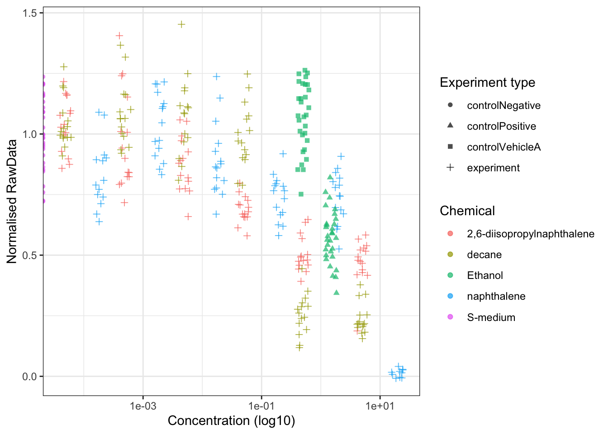

# Analyse reproduceren

## Data inlezen


``` r
data <- read_excel("data/CE.LIQ.FLOW.062_Tidydata.xlsx", sheet = "expParameters")
```

## Data inspecteren


``` r
head(data)
```

```
## # A tibble: 6 × 34
##   plateRow plateColumn vialNr dropCode expType    expReplicate expName        
##   <lgl>    <lgl>        <dbl> <chr>    <chr>             <dbl> <chr>          
## 1 NA       NA               1 a        experiment            3 CE.LIQ.FLOW.062
## 2 NA       NA               1 b        experiment            3 CE.LIQ.FLOW.062
## 3 NA       NA               1 c        experiment            3 CE.LIQ.FLOW.062
## 4 NA       NA               1 d        experiment            3 CE.LIQ.FLOW.062
## 5 NA       NA               1 e        experiment            3 CE.LIQ.FLOW.062
## 6 NA       NA               2 a        experiment            3 CE.LIQ.FLOW.062
## # ℹ 27 more variables: expDate <dttm>, expResearcher <chr>, expTime <dbl>,
## #   expUnit <chr>, expVolumeCounted <dbl>, RawData <dbl>, compCASRN <chr>,
## #   compName <chr>, compConcentration <chr>, compUnit <chr>,
## #   compDelivery <chr>, compVehicle <chr>, elegansStrain <chr>,
## #   elegansInput <dbl>, bacterialStrain <chr>, bacterialTreatment <chr>,
## #   bacterialOD600 <dbl>, bacterialConcX <dbl>, bacterialVolume <dbl>,
## #   bacterialVolUnit <chr>, incubationVial <chr>, incubationVolume <dbl>, …
```

``` r
str(data)
```

```
## tibble [360 × 34] (S3: tbl_df/tbl/data.frame)
##  $ plateRow           : logi [1:360] NA NA NA NA NA NA ...
##  $ plateColumn        : logi [1:360] NA NA NA NA NA NA ...
##  $ vialNr             : num [1:360] 1 1 1 1 1 2 2 2 2 2 ...
##  $ dropCode           : chr [1:360] "a" "b" "c" "d" ...
##  $ expType            : chr [1:360] "experiment" "experiment" "experiment" "experiment" ...
##  $ expReplicate       : num [1:360] 3 3 3 3 3 3 3 3 3 3 ...
##  $ expName            : chr [1:360] "CE.LIQ.FLOW.062" "CE.LIQ.FLOW.062" "CE.LIQ.FLOW.062" "CE.LIQ.FLOW.062" ...
##  $ expDate            : POSIXct[1:360], format: "2020-11-30" "2020-11-30" ...
##  $ expResearcher      : chr [1:360] "Sergio Reijnders - Ellis Herder" "Sergio Reijnders - Ellis Herder" "Sergio Reijnders - Ellis Herder" "Sergio Reijnders - Ellis Herder" ...
##  $ expTime            : num [1:360] 68 68 68 68 68 68 68 68 68 68 ...
##  $ expUnit            : chr [1:360] "hour" "hour" "hour" "hour" ...
##  $ expVolumeCounted   : num [1:360] 50 50 50 50 50 50 50 50 50 50 ...
##  $ RawData            : num [1:360] 44 37 45 47 41 35 41 36 40 38 ...
##  $ compCASRN          : chr [1:360] "24157-81-1" "24157-81-1" "24157-81-1" "24157-81-1" ...
##  $ compName           : chr [1:360] "2,6-diisopropylnaphthalene" "2,6-diisopropylnaphthalene" "2,6-diisopropylnaphthalene" "2,6-diisopropylnaphthalene" ...
##  $ compConcentration  : chr [1:360] "4.99" "4.99" "4.99" "4.99" ...
##  $ compUnit           : chr [1:360] "nM" "nM" "nM" "nM" ...
##  $ compDelivery       : chr [1:360] "Liquid" "Liquid" "Liquid" "Liquid" ...
##  $ compVehicle        : chr [1:360] "controlVehicleA" "controlVehicleA" "controlVehicleA" "controlVehicleA" ...
##  $ elegansStrain      : chr [1:360] "N2" "N2" "N2" "N2" ...
##  $ elegansInput       : num [1:360] 25 25 25 25 25 25 25 25 25 25 ...
##  $ bacterialStrain    : chr [1:360] "OP50" "OP50" "OP50" "OP50" ...
##  $ bacterialTreatment : chr [1:360] "heated" "heated" "heated" "heated" ...
##  $ bacterialOD600     : num [1:360] 0.743 0.743 0.743 0.743 0.743 0.743 0.743 0.743 0.743 0.743 ...
##  $ bacterialConcX     : num [1:360] 8 8 8 8 8 8 8 8 8 8 ...
##  $ bacterialVolume    : num [1:360] 300 300 300 300 300 300 300 300 300 300 ...
##  $ bacterialVolUnit   : chr [1:360] "ul" "ul" "ul" "ul" ...
##  $ incubationVial     : chr [1:360] "1,5 glass vial" "1,5 glass vial" "1,5 glass vial" "1,5 glass vial" ...
##  $ incubationVolume   : num [1:360] 1000 1000 1000 1000 1000 1000 1000 1000 1000 1000 ...
##  $ incubationUnit     : chr [1:360] "ul" "ul" "ul" "ul" ...
##  $ incubationMethod   : chr [1:360] "rockroll" "rockroll" "rockroll" "rockroll" ...
##  $ incubationRPM      : num [1:360] 35 35 35 35 35 35 35 35 35 35 ...
##  $ bubble             : logi [1:360] NA NA NA NA NA NA ...
##  $ incubateTemperature: num [1:360] 20 20 20 20 20 20 20 20 20 20 ...
```

## Scatterplot van de ruwe data


``` r
data$compConcentration <- as.numeric(data$compConcentration)

ggplot(data, aes(
  x = compConcentration, y = RawData,
  colour = compName, shape = expType)) +
  geom_point(position = position_jitter(width = 0.1, height = 0.5), alpha = 0.7) +
  scale_x_log10() +
  labs(x = "Concentration (log10)", y = "RawData",
    colour = "Chemical", shape = "Experiment type") +
  theme_bw()
```


## Data normaliseren


``` r
negative_mean <- mean(data$RawData[data$expType == "controlNegative"], na.rm = TRUE)

data$normalised <- data$RawData / negative_mean

mean(data$normalised[data$expType == "controlNegative"], na.rm = TRUE)
```

```
## [1] 1
```

## Scatterplot van de genormaliseerde data


``` r
ggplot(data, aes(x = compConcentration, y = normalised,
  colour = compName, shape = expType)) +
  geom_point(position = position_jitter(width = 0.1, height = 0.01), alpha = 0.7) +
  scale_x_log10() +
  labs(x = "Concentration (log10)", y = "Normalised RawData",
    colour = "Chemical", shape = "Experiment type") +
  theme_bw()
```



## Uitleg van de analyse

- De negatieve controle in dit experiment is S-medium zonder toegevoegde chemische stoffen. Dit dient als baseline om de normale voortplanting te meten. De positieve controle is ethanol en dient om te controleren of het experiment een bepaald effect kan aantonen.

- De negatieve controle geeft de normale situatie weer. De positieve controle laat zien of het experiment een effect kan detecteren. De vehicle control controleert of het oplosmiddel zelf invloed heeft op de resultaten.

- De normalisatie zorgt ervoor dat het gemiddelde van de negatieve controle gelijk wordt aan 1. Zo kunnen alle andere meetwaarden op een eerlijke manier worden vergeleken met de normale situatie.


## Stappenplan dose-response analyse

Voor vervolgonderzoek kan een dose-response analyse worden uitgevoerd om de IC50 te bepalen (met behulp van R-package `drc`)

1. Het package `drc` installeren.
2. Een chemische stof selecteren en de bijbehorende concentraties & waarden gebruiken
3. Een dose-response model maken met een log-logistisch model
4. De dose-response curve bekijken
5. IC50 berekenen.
