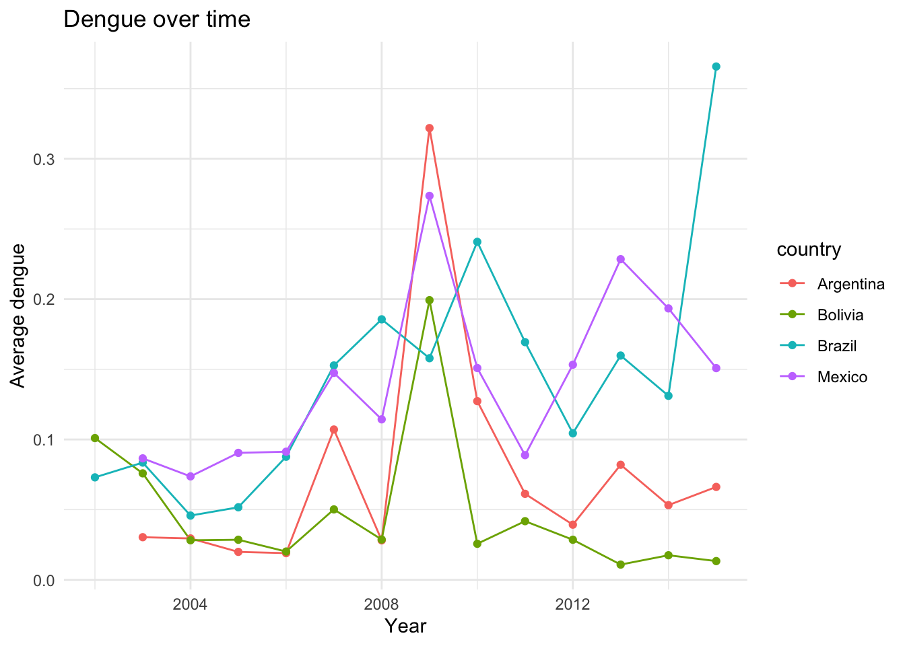
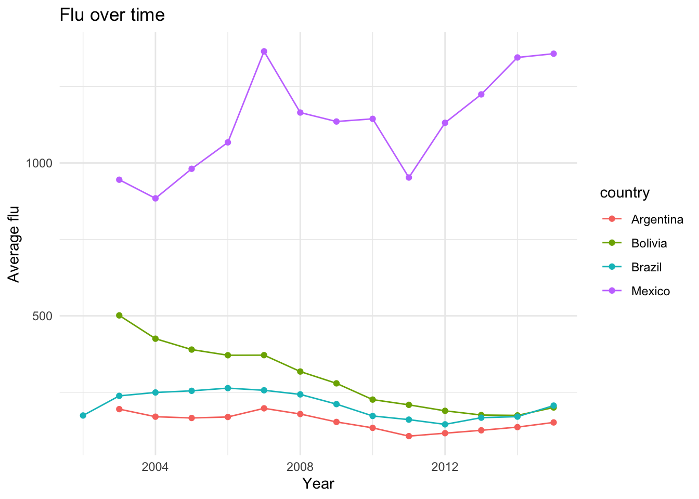

# SQL

## Loading the datasets

We load the dengue and flu datasets from local CSV files. The Gapminder dataset is loaded from the dslabs package.


``` r
library(tidyverse)
library(dslabs)

dengue <- read_csv("data/dengue_data.csv", skip = 11)
flu <- read_csv("data/flu_data.csv", skip = 11)
gapminder_data <- gapminder
```

## Checking and making the datasets tidy

The dengue and flu datasets are initially stored in wide format, with each country represented by a separate column. We transform these datasets into long format using `pivot_longer()`.


``` r
dengue_tidy <- dengue %>%
  pivot_longer(cols = -Date, names_to = "country", values_to = "dengue")

flu_tidy <- flu %>%
  pivot_longer(cols = -Date,names_to = "country", values_to = "flu")
```

The Gapminder dataset is already in tidy format.

## Standardizing country and date variables

The dengue and flu datasets contain weekly dates, while Gapminder contains yearly data. We standardize the country and year variables to make the datasets compatible for joining.


``` r
dengue_tidy <- dengue_tidy %>%
  mutate(country = as.character(country), 
         year = as.integer(substr(Date, 1, 4)))

flu_tidy <- flu_tidy %>%
  mutate(country = as.character(country), 
         year = as.integer(substr(Date, 1, 4)))

gapminder_tidy <- gapminder_data %>%
  mutate(country = as.character(country))
```


The datasets now have matching data types for `country` and `year`.

## Checking country names


The country names were checked across all three datasets using `unique()`. The datasets contain different numbers of countries, but four countries are present in all three: Argentina, Bolivia, Brazil and Mexico.

## Preparing the datasets for joining

Only countries present in all three datasets are selected. The weekly dengue and flu data are summarized into yearly averages to match the yearly Gapminder data.


``` r
# Select countries present in all three datasets
common_countries <- unique(dengue_tidy$country[
  dengue_tidy$country %in% flu_tidy$country &
  dengue_tidy$country %in% gapminder_tidy$country])

# Filter all datasets
dengue_tidy <- dengue_tidy %>%
  filter(country %in% common_countries)

flu_tidy <- flu_tidy %>%
  filter(country %in% common_countries)

gapminder_tidy <- gapminder_tidy %>%
  filter(country %in% common_countries)

# Calculate yearly averages
dengue_yearly <- dengue_tidy %>%
  group_by(country, year) %>%
  summarise(dengue = mean(dengue, na.rm = TRUE), .groups = "drop")

flu_yearly <- flu_tidy %>%
  group_by(country, year) %>%
  summarise(flu = mean(flu, na.rm = TRUE), .groups = "drop")
```

The dengue and flu datasets now contain yearly averages for each country. This allows them to be joined with Gapminder using `country` and `year`.

## Saving the datasets

The three prepared datasets are saved as CSV files so they can be imported into PostgreSQL.


``` r
write_csv(dengue_yearly, "data/dengue_yearly.csv")
write_csv(flu_yearly, "data/flu_yearly.csv")
write_csv(gapminder_tidy, "data/gapminder.csv")
```

## Importing and joining the datasets using SQL

The three CSV files were imported into the PostgreSQL database `workflowsdb` using DBeaver. Each dataset was stored in a separate table: `dengue_yearly`, `flu_yearly` and `gapminder`.

We used SQL queries to inspect the tables and combine the datasets using `INNER JOIN`, matching records based on the shared `country` and `year` variables.

```sql
SELECT *
FROM dengue_yearly AS dengue
INNER JOIN flu_yearly AS flu
    ON dengue.country = flu.country
    AND dengue.year = flu.year
INNER JOIN gapminder AS gapminder
    ON dengue.country = gapminder.country
    AND dengue.year = gapminder.year;
```

## Visualizing the joined data

We load the joined dataset exported from PostgreSQL as a CSV file and visualize the yearly dengue and flu data for the four countries. Two separate line graphs are created to show how dengue and flu values change over time.


``` r
joined_data <- read_csv("data/joined_data.csv")

# Dengue
ggplot(joined_data, aes(x = year, y = dengue, color = country)) +
  geom_line() +
  geom_point() +
  labs(title = "Dengue over time", x = "Year", y = "Average dengue") +
  theme_minimal()
```



``` r
# Flu
ggplot(joined_data, aes(x = year, y = flu, color = country)) +
  geom_line() +
  geom_point() +
  labs(title = "Flu over time", x = "Year", y = "Average flu") +
  theme_minimal()
```


