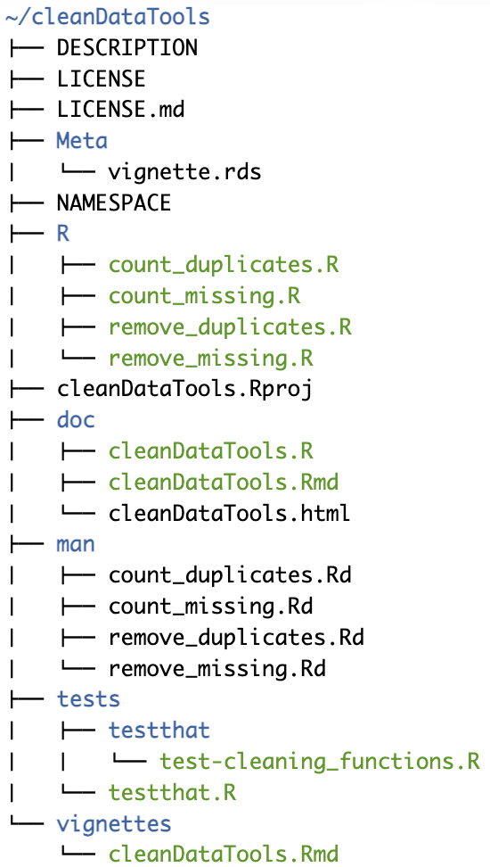
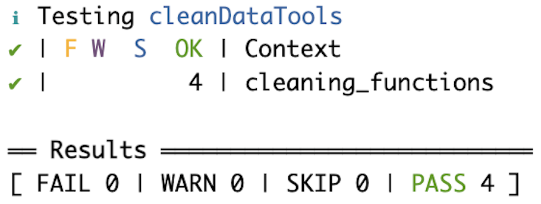

# R Package

## Introduction

For this assignment, I developed my own R package: **cleanDataTools**. The goal of this assignment was to learn how to create an R package and make it available to others through GitHub.

I chose to develop a package containing simple functions for checking and cleaning datasets. During data analysis, it is important to first assess the quality of a dataset. Missing values and duplicate observations, for example, can affect further analyses and their results.

With cleanDataTools, I aim to combine several commonly used data cleaning operations into a single package, allowing me to reuse these functions in future analyses.

## Functions

My package contains four self-written functions. Each function is stored in a `.R` file in the directory.

| Function | Description |
|---|---|
| `count_missing()` | Counts the number of missing values (`NA`) in each column. |
| `remove_missing()` | Removes rows containing one or more missing values. |
| `count_duplicates()` | Counts the number of duplicate rows in a dataset. |
| `remove_duplicates()` | Removes duplicate rows while keeping the first occurrence. |

These functions help check and clean datasets before they are used for further analysis.

## Package structure

During the development of the package, I used the R packages `usethis` and `devtools`. These packages allowed me to set up the structure of my own package and manage its different components.

The structure of my package looks as follows:

{ width=40% }

The main components are:

- **DESCRIPTION:** Contains information about the package, such as its name, version, author and description.
- **R:** Contains the four separate files with my functions.
- **man:** Contains the documentation for the functions.
- **NAMESPACE:** Determines which functions are made available to package users.
- **tests:** Contains tests that I used to check whether the functions work correctly.
- **vignettes:** Contains explanations and examples of how to use the package.

## Documentation

For the documentation of my functions, I used roxygen2 comments. These describe, among other things, the parameters, output and examples of the functions.

I then used the `devtools::document()` command to generate the documentation files and the NAMESPACE file.

## Testing

To check whether my functions work correctly, I wrote a test for each of the functions using `testthat`. The tests check, among other things, whether missing values are counted correctly, duplicate rows are removed and the correct number of duplicate rows is reported.

When running `devtools::test()`, all four tests passed.

{ width=50% }

## Vignette

I also added a vignette explaining what the package does and how the different functions can be used. The vignette includes examples that allow users to try out the functions themselves.

I checked whether the vignette was available using:

```r
browseVignettes("cleanDataTools")
```

## Publishing on GitHub

As the final step, I published my package in a public GitHub repository. This allows others to view my code and install the package themselves.

The package can be installed directly from R using:

```r
devtools::install_github("davalyn/cleanDataTools")
```

After installation, the package can be loaded using:

```r
library(cleanDataTools)
```

I tested the installation myself and then ran all four functions again. All functions produced the expected results.

{ width=100% }

**GitHub-repository:** [cleanDataTools](https://github.com/davalyn/cleanDataTools)

## Reflection

During this assignment, I learned how an R package is structured and which components are needed to make custom functions available to others in an organised way.

Working with separate function files, roxygen2 documentation and testing functions was particularly educational. I also learned how GitHub can be used to share code and how a package can be installed directly from a repository.

An important insight is that creating reusable functions is not only convenient for personal use but also contributes to reproducible research. By documenting functions and combining them into a package, the same steps can be performed consistently across different analyses.

In the future, I can further expand cleanDataTools by adding additional data cleaning functions. This will allow me to continue using and improving the package in future data analyses.
