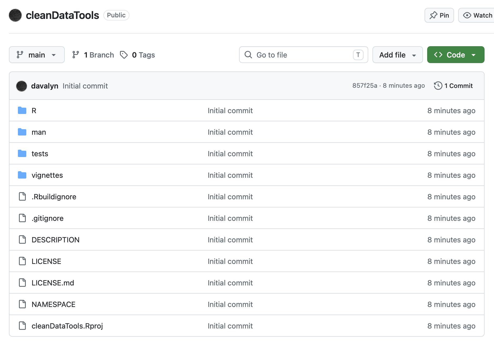

# R package

## Introductie

Voor deze opdracht heb ik mijn eigen R-package ontwikkeld: **cleanDataTools**. Het doel van deze opdracht was om te leren hoe je zelf een R-package maakt en beschikbaar stelt aan anderen via GitHub.

Ik heb gekozen voor een package met eenvoudige functies voor het controleren en opschonen van datasets. Tijdens data-analyses is het belangrijk om eerst de kwaliteit van een dataset te controleren. Ontbrekende waarden en dubbele observaties kunnen bijvoorbeeld invloed hebben op de verdere analyse en de resultaten.

Met cleanDataTools wil ik een aantal veelgebruikte handelingen voor datacleaning bundelen in één package, zodat ik deze functies bij toekomstige analyses opnieuw kan gebruiken.

## De functies

Mijn package bevat vier zelfgeschreven functies. Elke functie staat in een afzonderlijk `.R`-bestand in de map `R/`.

| Functie | Beschrijving |
|---|---|
| `count_missing()` | Telt het aantal ontbrekende waarden (`NA`) per kolom. |
| `remove_missing()` | Verwijdert rijen waarin één of meerdere waarden ontbreken. |
| `count_duplicates()` | Telt het aantal dubbele rijen in een dataset. |
| `remove_duplicates()` | Verwijdert dubbele rijen en behoudt de eerste voorkomende rij. |

Deze functies helpen bij het controleren en opschonen van datasets voordat deze verder worden geanalyseerd.

## Opbouw van het package

Bij het ontwikkelen van het package heb ik gebruikgemaakt van de R-packages `usethis` en `devtools`. Met behulp van deze packages kon ik de structuur van mijn eigen package opzetten en de verschillende onderdelen beheren.

De structuur van mijn package ziet er als volgt uit:

{ width=40% }

De belangrijkste onderdelen zijn:

- **DESCRIPTION:** bevat informatie over het package, zoals de naam, versie, auteur en beschrijving.
- **R:** bevat de vier afzonderlijke bestanden met mijn functies.
- **man:** bevat de documentatie van de functies.
- **NAMESPACE:** bepaalt welke functies beschikbaar worden gemaakt voor gebruikers van het package.
- **tests:** bevat tests waarmee ik heb gecontroleerd of de functies correct werken.
- **vignettes:** bevat een uitleg en voorbeelden van het gebruik van het package.

## Documentatie

Voor de documentatie van mijn functies heb ik roxygen2-comments gebruikt. Hiermee worden onder andere de parameters, uitvoer en voorbeelden van de functies beschreven.

Met het commando `devtools::document()` heb ik vervolgens de documentatiebestanden en het NAMESPACE-bestand gegenereerd.

## Testen

Om te controleren of mijn functies correct werken, heb ik voor alle vier de functies een test geschreven met behulp van `testthat`.

De tests controleren onder andere of ontbrekende waarden correct worden geteld, dubbele rijen worden verwijderd en het juiste aantal dubbele rijen wordt gerapporteerd.

Bij het uitvoeren van `devtools::test()` slaagden alle vier de tests.

{ width=50% }

## Vignette

Ik heb ook een vignette toegevoegd waarin wordt uitgelegd wat het package doet en hoe de verschillende functies gebruikt kunnen worden. De vignette bevat voorbeelden waarmee gebruikers de functies zelf kunnen uitproberen.

Ik heb gecontroleerd of de vignette beschikbaar was met:

```r
browseVignettes("cleanDataTools")
```

## Publiceren op GitHub

Als laatste stap heb ik mijn package gepubliceerd in een openbare GitHub-repository. Hierdoor kunnen anderen mijn code bekijken en het package zelf installeren.

Het package kan rechtstreeks vanuit R worden geïnstalleerd met:

```r
devtools::install_github("davalyn/cleanDataTools")
```

Na installatie kan het package worden geladen met:

```r
library(cleanDataTools)
```

Ik heb deze installatie zelf getest en vervolgens alle vier de functies opnieuw uitgevoerd. Alle functies gaven de verwachte resultaten.

{ width=100% }

**GitHub-repository:** [cleanDataTools](https://github.com/davalyn/cleanDataTools)

## Reflectie

Tijdens deze opdracht heb ik geleerd hoe een R-package is opgebouwd en welke onderdelen nodig zijn om eigen functies op een gestructureerde manier beschikbaar te maken voor anderen.

Vooral het werken met afzonderlijke functiebestanden, roxygen2-documentatie en het testen van functies was leerzaam. Ik heb ook ervaren hoe GitHub gebruikt kan worden om code te delen en hoe een package rechtstreeks vanuit een repository geïnstalleerd kan worden.

Een belangrijk inzicht is dat het maken van herbruikbare functies niet alleen handig is voor jezelf, maar ook bijdraagt aan reproduceerbaar werken. Door functies te documenteren en samen te voegen in een package, kunnen dezelfde stappen bij verschillende analyses op een consistente manier worden uitgevoerd.

In de toekomst kan ik cleanDataTools verder uitbreiden met aanvullende functies voor datacleaning. Zo kan ik het package blijven gebruiken en verbeteren tijdens volgende data-analyses.
